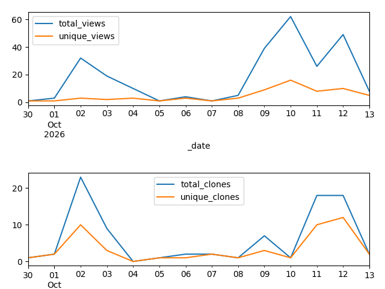

# 📊 Arca-BrainOS : Repository Traffic Analytics

This branch permanently archives GitHub traffic metrics (clones, views, and unique visitors) past GitHub's default 14-day retention window.

## 📈 Overview Plots (Views & Clones)

## 📁 Historical Data Files

* [traffic/views.csv](traffic/views.csv) : Daily views and unique visitors.
* [traffic/clones.csv](traffic/clones.csv) : Daily clones and unique cloners.

---
*Updated automatically every night at 02:00 UTC via [Repository Traffic Action](https://github.com/sangonzal/repository-traffic-action).*
